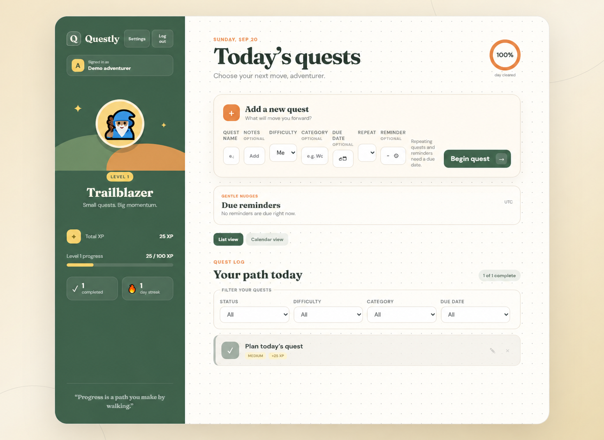
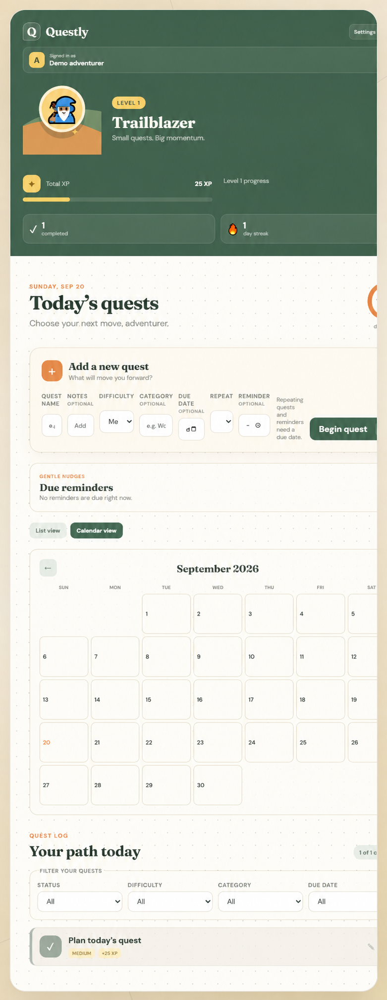
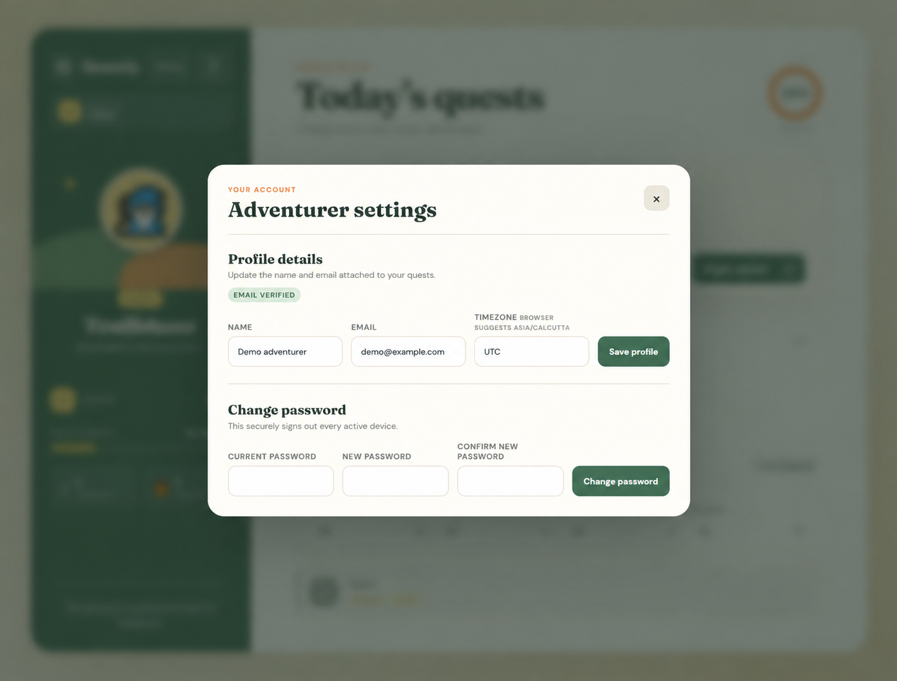

# Questly — Gamified Productivity Tracker

Questly is a gamified productivity tracker.

```text
React client → Express API → MongoDB Atlas
```

## Live Demo

[Open Questly](https://questly-gamified-productivity.onrender.com)

This is the demo URL listed by the project. Its current availability, deployed commit, and end-to-end functionality have not been verified in this README.

## Deployment status

This repository includes deployment preparation, configuration guidance, and production build commands. Phase 10 documented preparation without an external deployment. The later addition of a demo link does not establish which deployment steps were completed.

**External deployment evidence required:** confirm the deployed version, hosting configuration, database connectivity, authentication behavior, and applicable checklist items before marking deployment as verified.

## Screenshots

### Dashboard



### Calendar planning



### Account settings



## Required environment values

Create `server/.env` locally from `server/.env.example`. Never commit it.

```text
PORT=5000
NODE_ENV=development
CLIENT_ORIGIN=http://localhost:5173
MONGODB_URI=your-mongodb-connection-string
JWT_SECRET=a-long-random-secret
JWT_EXPIRES_IN=7d
COOKIE_SECURE=false
COOKIE_SAME_SITE=lax
TRUST_PROXY=false
```

Email verification and password recovery also need the SMTP settings listed in `server/.env.example`.

The client may use `VITE_API_URL`, for example `http://localhost:5000`. It is a **public build-time URL**, not a secret. Never put `JWT_SECRET`, SMTP passwords, or MongoDB credentials in a `VITE_` variable.

## Local production build

```powershell
cd server
npm ci
npm run typecheck
npm test
npm run build
npm start
```

In a separate terminal, starting from the repository root:

```powershell
cd client
npm ci
npm run lint
npm run build
npm run preview
```

The backend production command runs compiled JavaScript from `server/dist`; development remains `npm run dev`. In production, Express can also serve the built client from `client/dist`, so separate frontend and API hosting is optional. `npm run preview` is for local build inspection.

## Health checks

- `GET /api/health` is a liveness check. It returns `200` even if MongoDB is down, so a platform can tell that the HTTP process is alive.
- `GET /api/ready` is a readiness check. It returns `200` only when Mongoose is connected; otherwise it returns a safe `503` response.

Use liveness for process monitoring and readiness before routing database-backed traffic to an instance.

## Cookies, CORS, and proxies

Set `CLIENT_ORIGIN` to the exact React origin. If it is unset, the API falls back to `RENDER_EXTERNAL_URL`; verify that this matches the frontend origin for your hosting arrangement. The API keeps `credentials: true` and never uses `*` for credentialed CORS.

For one same-site deployment, use HTTPS in production with:

```text
COOKIE_SECURE=true
COOKIE_SAME_SITE=lax
```

For separate frontend and API sites, use:

```text
COOKIE_SECURE=true
COOKIE_SAME_SITE=none
```

`SameSite=None` requires `Secure=true`, and secure cookies require HTTPS. If the API is behind a known reverse proxy, set `TRUST_PROXY` to its exact hop count, commonly `1`. Do not set it to a broad trust-all value: Express and rate limiting rely on this setting when identifying client IP addresses.

## Docker image builds

Docker is optional. These commands build images but do not run or publish them:

```powershell
docker build -t questly-api-test ./server
docker build --build-arg VITE_API_URL=https://api.example.com -t questly-client-test ./client
```

The Docker ignore files exclude `.env`, dependencies, tests, Git metadata, and build output. Supply server environment values when running a container; do not bake them into an image.

## MongoDB Atlas guidance

- Add only the deployment network addresses required by your host.
- Create a dedicated database user for Questly with the smallest practical role on its own database.
- Store its connection string only in the host's secret manager or server environment.
- Never use Atlas as a substitute for the in-memory test database.

## Deployment verification checklist

Unchecked items indicate that completion has not been verified here. For each completed item, record the verification date, deployed commit, and supporting evidence without exposing secrets.

- [ ] Verify the hosting provider, HTTPS URL(s), and whether the client and API share one origin.
- [ ] Verify required server secrets are configured in the provider.
- [ ] Verify the effective client origin matches the deployed frontend.
- [ ] Verify cookie settings and browser authentication for the actual hosting arrangement.
- [ ] Verify `TRUST_PROXY` matches the platform's proxy topology, if applicable.
- [ ] Verify Atlas network restrictions and a least-privilege database user.
- [ ] Verify SMTP configuration and actual verification/recovery email delivery, if required; otherwise record this as not configured.
- [ ] Record successful server typecheck/tests/build and client lint/build results for the deployed commit.
- [ ] Verify live `/api/health` and `/api/ready` responses and the platform's configured health-check endpoint(s).

## Current operational limits

Rate limits use in-memory storage, which is suitable for one API instance. Before horizontal scaling, move rate-limit state to a shared store such as Redis.

Task reminders are displayed only while the browser is open. Questly currently has no email, push, cron, or background-job reminder delivery.
